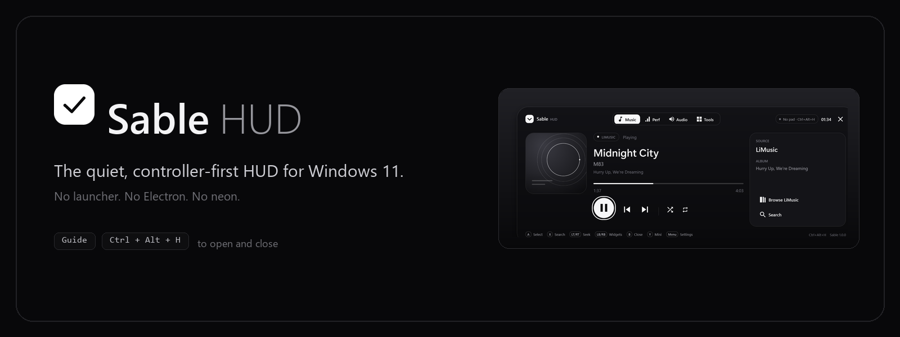
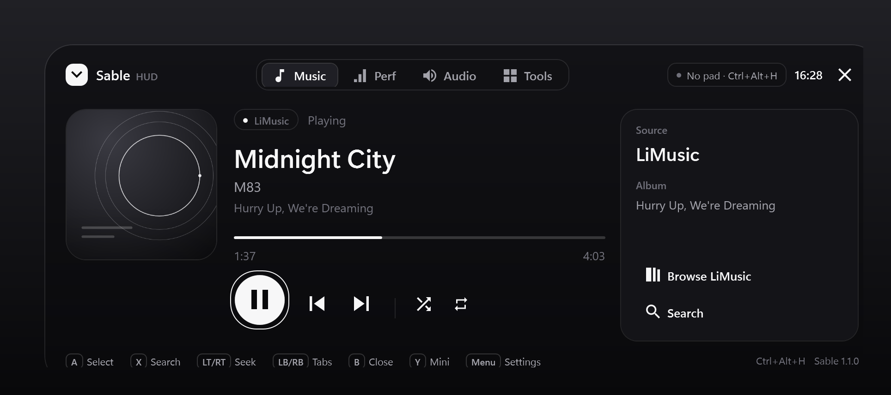
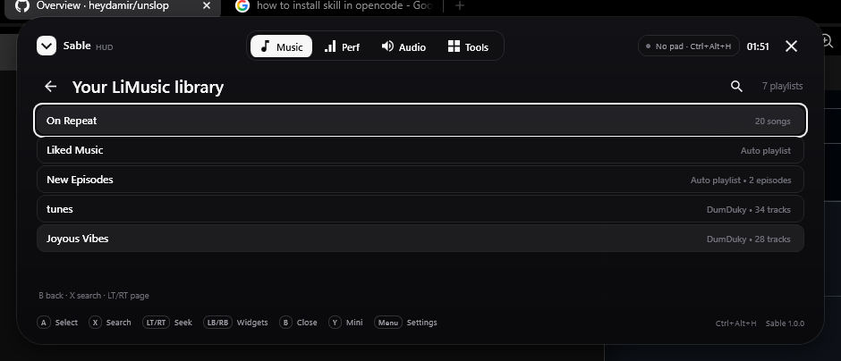
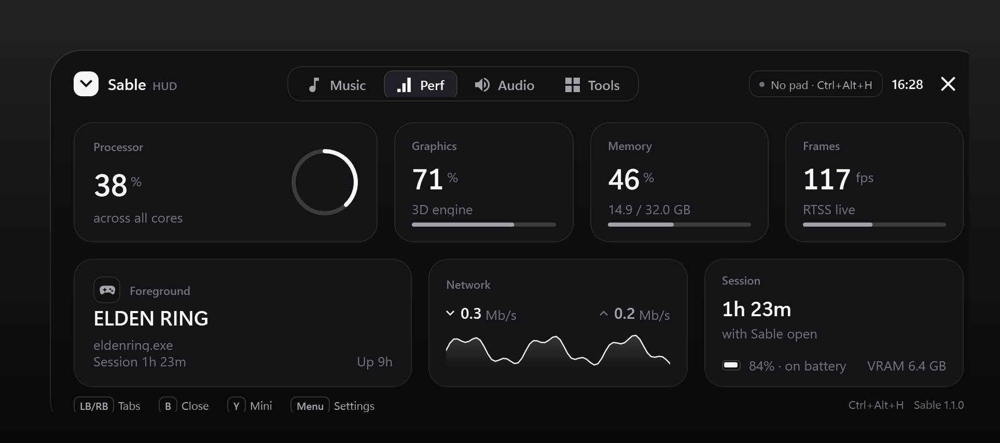
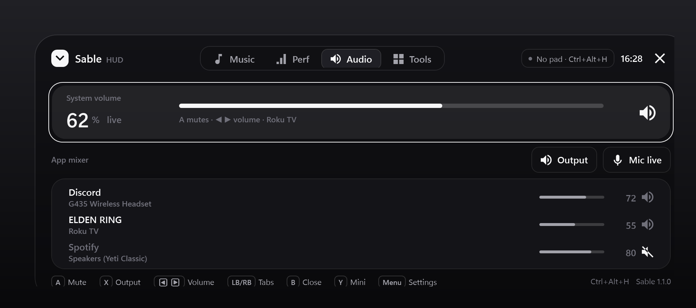
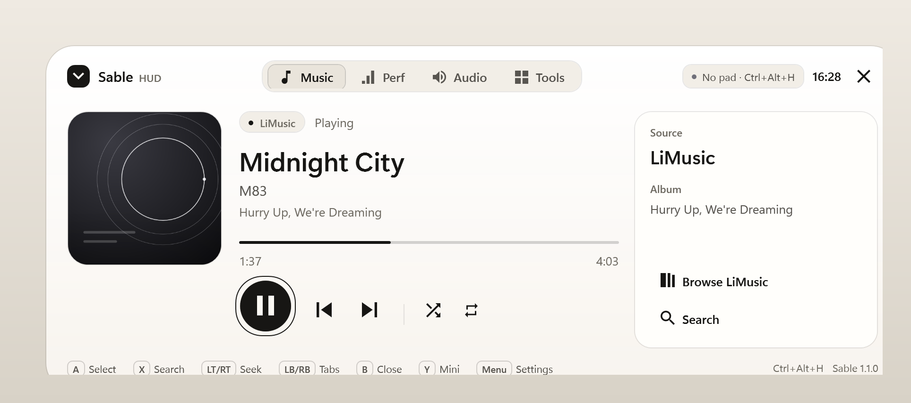

<p align="center">
  
</p>

<p align="center">
  <a href="https://github.com/DumDuky/sable-hud/releases/latest"></a>
  
  
  <a href="LICENSE"></a>
</p>

<p align="center">
  <b>One press of the Xbox button. Everything you need, nothing you don't.</b><br>
  Music, performance, audio and tools in a monochrome overlay that drops from the top of the screen and leaves when you're done.
</p>

<p align="center">
  <a href="https://github.com/DumDuky/sable-hud/releases/latest"></a>
</p>

<p align="center">
  
</p>
<p align="center"><sub>Your LiMusic library, inside the HUD. No second window, no alt-tab.</sub></p>

## Why Sable

Most gaming overlays want you to alt-tab, or install a second store, or accept a neon panel over your game. Sable is the opposite: a quiet, rounded HUD that only exists while you hold the controller.

- **One button.** The Guide press opens Sable once Game Bar's controller shortcut is off. Press it again and it is gone.
- **A controller is the interface.** D-pad and left stick in all four directions, A/B/X/Y, bumpers, triggers and a cursor you can read from a couch.
- **Quiet by default.** Ink, paper and graphite. Four monochrome themes. No launcher, no Electron, no telemetry.
- **One self-contained exe.** No runtime install, no background service, no driver unless you ask for one.

## Install

1. Download **`SableHUD-win-x64.zip`** from [Releases](https://github.com/DumDuky/sable-hud/releases/latest) and unpack it, or grab `SableHUD.exe` directly.
2. Run `SableHUD.exe`. For a Start Menu shortcut, run `install.ps1` instead; it installs to `%LOCALAPPDATA%\SableHUD`.
3. Turn off Game Bar's controller shortcut once: **Settings → Gaming → Game Bar → Open Game Bar using this button on a controller → Off**.
4. Press the **Xbox/Guide** button, or `Ctrl + Alt + H`.

The build is unsigned, so SmartScreen may ask once. Choose **More info → Run anyway**.

| | |
|---|---|
| Windows | 10 version 2004+ or 11, x64 |
| Runtime | none for `SableHUD.exe`; the framework-dependent build needs the [.NET 8 Desktop Runtime](https://dotnet.microsoft.com/download/dotnet/8.0) |
| Controller | any XInput pad; the Guide button needs `XInputGetStateEx` |
| LiMusic | optional, installed separately, for the music widget |
| RTSS | optional, for the FPS reading |
| .NET 8 SDK | only to build from source |

## What's inside

### Music

A controller-sized browser for your signed-in LiMusic library. Open playlists, search with an on-screen keyboard, and press A to play. The playlist becomes the queue, so playback continues to the next track and into radio when autoplay is on. Artwork follows the song or the playlist you started from, and radio tracks keep their own cover.

The overlay always opens on the Music tab with the cursor on play/pause, so one press pauses whatever is playing. With nothing loaded, the cursor falls back to **Browse LiMusic**, the only action that can start something.

<p align="center">
  
</p>
<p align="center"><sub>Captured from the running app: the library browser, 34 tracks, real LiMusic data.</sub></p>

### Performance

CPU, GPU, VRAM, RAM, network, foreground app, session time, battery, controller battery and optional RTSS FPS. One page, no graphs you have to decode.

<p align="center">
  
</p>
<p align="center"><sub>Design render, representative telemetry.</sub></p>

### Audio

Master volume, microphone mute, a per-app mixer and per-app output routing through the same Windows route store as the system volume mixer. Discord is sorted first. On any volume row, left/right changes the level; A mutes; X opens the output picker.

Paused apps stay in the mixer, so an app can be muted or routed before it makes a sound; apps playing right now sort first. The three controls at the top are always reachable, even when no app has an audio session, and a muted app shows a slashed speaker that stays readable at row size.

<p align="center">
  
</p>

### Tools

Screenshot without the HUD in it, microphone mute, the Windows sound mixer, the Game Bar shortcut page, a LiMusic link and controller setup. Small actions, one press each.

### Optional pad isolation

Windows sends controller input to every app. Sable's isolation uses two drivers: **HidHide** hides the real pad from games, and **ViGEmBus** provides a virtual Xbox pad that Sable feeds. While the HUD is closed, the real pad is forwarded to the virtual one; the moment the HUD opens, the virtual pad goes neutral. A running game stops receiving input immediately, without a restart or a reload.

- Install **HidHide** from Settings → General → Controller isolation driver.
- Install **ViGEmBus** once from <https://github.com/nefarius/ViGEmBus/releases> if it is not already present.
- Turn on **Isolate pad while HUD is open**, then restart Sable so the virtual pad starts.

A game that was already running before the virtual pad appeared has the real pad handle and must be restarted once; games launched after Sable starts see the virtual pad and work with the HUD immediately. The browser gamepad tester must be reloaded once for the same reason.

Exiting Sable disconnects the virtual pad and releases the real one. A watchdog process also releases HidHide if Sable stops unexpectedly, and the tray/Settings have **Release controller**.

## Controls

| Input | Action |
|---|---|
| Xbox / Guide | Open or close the HUD (gesture configurable) |
| D-pad and left stick | Move the focus cursor in all four directions |
| A | Select: play/pause, open, route, type |
| B / View | Back one level; close the HUD when there is nothing to back out of |
| X | Music: search · Audio: output picker · Settings: dismiss |
| D-pad ← → on a volume row | Lower or raise that volume |
| Y | Toggle the mini player |
| LB / RB | Previous or next tab; previous or next Settings section |
| LT / RT | Music: seek −/+ 10 s · Audio: volume down/up (hold repeats) |
| Menu / Start | Open Settings |

`Ctrl + Alt + H` toggles the HUD and `Ctrl + Alt + N` toggles the mini player. Settings is fully navigable with the same pad: D-pad moves and scrolls, A activates, left/right changes a value, LB/RB changes section, B closes.

## Themes

| Theme | Character |
|---|---|
| **Noir** | near-black glass, white ink |
| **Graphite** | charcoal, softer contrast |
| **Ivory** | warm paper, black ink |
| **Porcelain** | cool white, black ink |

Settings → Appearance applies instantly to the HUD, mini player, toast and Settings window. HUD size is Compact, Comfortable or Large.

<p align="center">
  
</p>
<p align="center"><sub>Ivory. The same HUD, warm paper instead of glass.</sub></p>

## Music setup

Sable talks to LiMusic, a separate GPL-3.0 app by [SimoHypers](https://github.com/SimoHypers/limusic). Install it, sign in, then let Sable link the two.

- The HUD starts LiMusic with WebView2's **loopback-only** DevTools port and calls LiMusic's own typed commands over `127.0.0.1:9222`. Search, playlists, artwork, queue and playback are real LiMusic operations, not a lookalike index.
- If LiMusic is already open without the link, Sable asks before restarting it once, then minimizes it.
- The port is loopback-only and lives as long as the linked LiMusic process. It is never bound to a network interface.
- If the bridge is unavailable, the HUD still reads and controls any Windows media session through SMTC, including LiMusic.

LiMusic is not bundled with Sable and its source is not in this repository. See [NOTICE](NOTICE).

## Notes and limits

- **Exclusive fullscreen bypasses DWM.** Use borderless fullscreen.
- **The HUD opens on the primary monitor.** The mini player can sit anywhere.
- **FPS needs RTSS running.** Sable reads its shared memory; it does not inject.
- **Game Bar owns the first Xbox press** until its controller shortcut is off.
- **Per-app routing uses an undocumented Windows API.** It is capability-probed and falls back to the Windows mixer.
- **A LiMusic update can rename a command.** Transport falls back to SMTC; browse and search may need a Sable update.
- **HidHide is a driver.** If Sable crashes while cloaked, run Sable again or `HidHideCLI.exe --cloak-off`.

## Build from source

Requires Windows 10/11 x64 and the [.NET 8 SDK](https://dotnet.microsoft.com/download/dotnet/8.0).

```powershell
git clone https://github.com/DumDuky/sable-hud.git
cd sable-hud
.\build.ps1
```

Outputs:

| Path | What it is |
|---|---|
| `dist\SableHUD.exe` | self-contained single file |
| `dist\framework-dependent\SableHUD.exe` | needs the .NET 8 Desktop Runtime |
| `dist\SableHUD-win-x64.zip` | portable package with docs and the optional HidHide installer |

### Self-test

```powershell
.\dist\SableHUD.exe --selftest $env:TEMP\sable-selftest.json
```

Covers themes and resources, settings round-trip, Guide/toggle logic, the full controller map, XInput binding, audio sessions, GPU, system sampling, SMTC, the real LiMusic bridge when linked, local playback, RTSS and the app icon.

### Design renders

```powershell
.\dist\SableHUD.exe --render docs\screenshots
```

### Layout

```
src/SableHUD/
  Controls/      HudButton, ring, sparkline, progress
  Core/          settings, themes, window styles, hotkeys, app detection
  Input/         XInput, controller router, HidHide integration
  Media/         SMTC, LiMusic bridge, cover service, local engine
  SystemInfo/    CPU/GPU/RAM/network, PDH, RTSS, Core Audio, per-app routing
  Widgets/       Music + LiMusic browser, Performance, Audio, Tools
  Windows/       Overlay, mini player, toast, settings, tray
```

## Docs

| | |
|---|---|
| [Technical notes](docs/TECHNICAL.md) | architecture, refresh loop, bridge, routing |
| [Themes](docs/THEMES.md) | the four palettes and how they are applied |
| [Verification](docs/VERIFICATION.md) | what was tested on real hardware and LiMusic |
| [Screenshots](docs/screenshots) | renders and live captures |
| [Contributing](CONTRIBUTING.md) | build, test and controller-test checklist |

## Credits

- **LiMusic** — © SimoHypers and contributors, GPL-3.0. The music browser is built around LiMusic's own signed-in backend. <https://github.com/SimoHypers/limusic>
- **NAudio** — MIT. Core Audio and local playback.
- **TagLib#** — LGPL-2.1. Local metadata.
- **WinAudioRoute** — MIT. Per-app output routing.
- **HidHide** — MIT, © Eric Korff de Gidts and Benjamin Höglinger-Stelzer. Optional controller isolation.

Sable HUD is GPL-3.0. See [LICENSE](LICENSE) and [NOTICE](NOTICE). Not affiliated with Microsoft, Discord, Spotify or YouTube.

<p align="center"><sub>If Sable earns a place in your setup, star the repo so the next controller player can find it.</sub></p>
